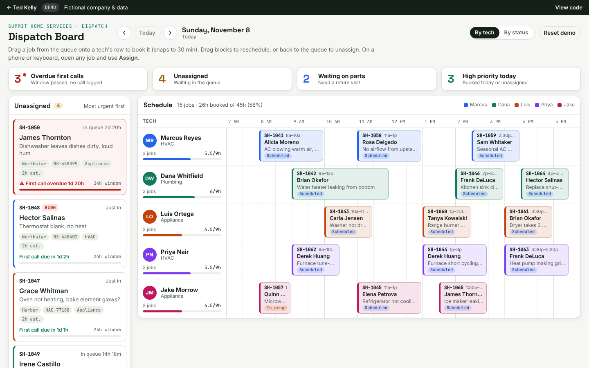

# Dispatch Board

See the whole day for every tech on one screen, drag jobs onto the schedule, and catch late warranty first calls before they cost you.

**▶ [Live demo: tedkelly.dev/projects/dispatch-board](https://tedkelly.dev/projects/dispatch-board/)** · part of the [Service Business Toolkit](https://tedkelly.dev/projects/)



## The problem

Most small service shops dispatch out of a spreadsheet, a whiteboard and a stream of texts. New jobs sit unassigned because nobody notices them. Warranty companies give you 24 or 48 hours to make the first call to the customer, and they send less work to shops that miss it. And nobody can look up and see who is booked, who has room, and what is about to go wrong.

## What it does

- **Day timeline.** One row per tech, 7 AM to 6 PM in 30-minute slots. Each job shows the work order number, customer, issue and status. A red line marks the current time. Move between days with Previous, Next and Today.
- **Unassigned queue.** New jobs are listed most urgent first. Each one shows the warranty company, claim number, trade, how long it has been waiting, and a live countdown to its first-call deadline (worked out from when the job came in and that company's rule). A job turns red once the deadline has passed.
- **Drag and drop.** Drag a job from the queue onto a tech's row and it snaps to the nearest half hour. Drag a scheduled job to move it to another time or tech, or drag it back to the queue to unassign it. Every move can be undone.
- **Warnings that don't block you.** You are warned, but still allowed to proceed, when a job goes to a tech in the wrong trade (a plumbing job on an HVAC tech), overlaps another job, or pushes a tech past 9 hours.
- **Alerts strip.** Live counts for overdue first calls, unassigned jobs, jobs waiting on parts, and high-priority work today. Click one to highlight the matching jobs and jump to them, even when they are on another day.
- **Job details.** Customer phone (tap to call) and address, the warranty company, claim number, its first-call rule, and a timeline running from work order created → first call → scheduled → completed. From there you can log the first call, move the job to its next status, reassign or reschedule it, or unassign it.
- **Tech capacity.** Each row shows that tech's jobs for the day and their booked hours against a 9-hour day.
- **Works without a mouse.** On a phone, tap a job and either pick a tech and time or tap "Pick slot on board". Keyboard users can tab to any job, press Enter, and assign it from the form.

## Try it

https://tedkelly.dev/projects/dispatch-board/

Your changes are saved in your browser. "Reset demo" puts everything back.

## Built with

Plain HTML, CSS and JavaScript, with no framework and no build step. Drag and drop uses the browser's built-in HTML5 support, with a tap-to-place fallback for touch screens. State is stored in `localStorage`, and the shared demo data comes from `shared/data.js`. Light and dark mode follow the system setting. All times are in the visitor's local time zone.

Files: `index.html` (markup), `app.css` (layout), `app.js` (rules, rendering, drag and drop, drawer).

## Note

Summit Home Services, its techs, customers, warranty companies and claim numbers are all fictional. Dates are generated relative to today so the board always looks current.

## Run it locally

No install or build step. Clone the repo and open `index.html` in a browser, or serve the folder:

```bash
git clone https://github.com/TedKelly561/dispatch-board.git
cd dispatch-board
python3 -m http.server 8000   # then open http://localhost:8000
```

`shared/data.js` holds the fictional company (Summit Home Services) shared by every demo in the toolkit.

## More from the toolkit

- [Work Order Intake](https://github.com/TedKelly561/work-order-intake): messy email → clean service ticket
- [Quote Builder](https://github.com/TedKelly561/quote-builder): price-book quotes with margin view and approve links
- [Dispatch Board](https://github.com/TedKelly561/dispatch-board): drag-and-drop dispatch with first-call deadline alerts
- [Owner's KPI Dashboard](https://github.com/TedKelly561/kpi-dashboard): the numbers that run a service business

## About

Built by **Ted Kelly**, who runs a service business and builds the software behind it. Want something like this for your business? Visit **[tedkelly.dev](https://tedkelly.dev)**.

## License

[MIT](LICENSE). All companies, people, addresses and claim numbers in this demo are fictional.
